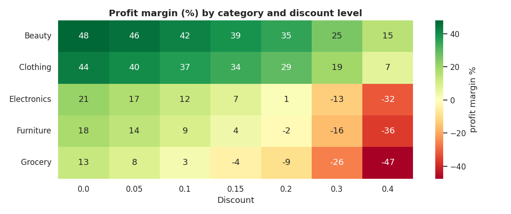
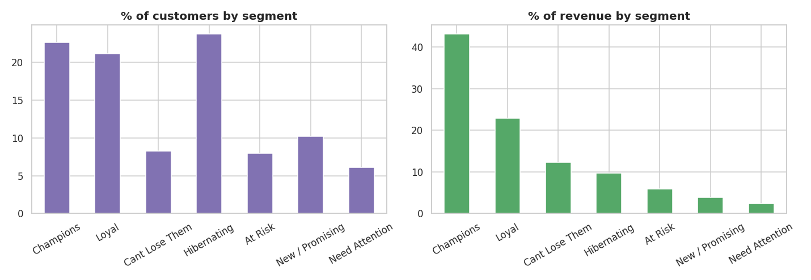

# 🛒 Retail Sales, Profitability & Customer Segmentation (RFM)

   

> **End-to-end analysis of 13.7k retail order lines: data cleaning → KPI reporting → profit leak diagnosis → RFM customer segmentation.**
> 📓 **[Open the notebook](notebooks/01_retail_sales_rfm_analysis.ipynb)**

## 🎯 Business problem
An online retailer sells Electronics, Furniture, Clothing, Grocery and Beauty across 4 regions. Management asks:
1. Where do we make (and lose) money?
2. How do discounts affect profit?
3. Which customers are most valuable, and which are about to churn?

## 📊 Key findings
| # | Insight | Evidence |
|---|---|---|
| 1 | **Revenue is concentrated in the lowest-margin category** | Electronics = 65% of revenue but only 9.3% margin; Beauty (44.5%) and Clothing (39.4%) are far more profitable |
| 2 | **Furniture earns ~zero profit** | Margin of -0.1% on ₹94 L revenue |
| 3 | **Deep discounts destroy profit** | 17.4% of line items lose money and 99% of those losses carry a discount of 20%+; orders discounted 30%+ are 13% of revenue but make a ₹16 L loss |
| 4 | **Festive-season peak** | Revenue spikes from October to December |
| 5 | **Small group of customers drives revenue** | Top 20% of customers = 58% of revenue; "Champions" are 23% of customers but 43% of revenue |
| 6 | **Win-back opportunity** | "At Risk" + "Can't Lose Them" customers hold ₹116.7 L of historical revenue but haven't ordered in roughly 8-10 months |




## 💡 Recommendations
1. Cap discounts at 10-15% for Electronics, Furniture and Grocery; keep deeper discounts only for Beauty/Clothing.
2. Renegotiate Furniture supplier cost and review shipping charges on bulky items.
3. Build inventory and ad budget ahead of the October-December peak.
4. Launch a loyalty programme for Champions/Loyal customers and a win-back campaign for At-Risk customers.

## 🧰 Skills demonstrated
`pandas` data cleaning (duplicates, missing values, inconsistent text, invalid values, date parsing) · feature engineering ·
`groupby` / `pivot_table` aggregation · KPI design · time-series trend analysis · RFM segmentation with quantile scoring ·
Pareto analysis · `matplotlib` / `seaborn` visual storytelling · translating numbers into business recommendations.

## 🗂️ Project structure
```
├── data/
│   ├── retail_orders_raw.csv        # messy input (duplicates, missing values, typos)
│   ├── retail_orders_clean.csv      # output of the cleaning step
│   └── rfm_segments.csv             # customer-level RFM scores and segments
├── notebooks/01_retail_sales_rfm_analysis.ipynb   # full analysis with outputs
├── images/                          # charts used in this README
├── src/generate_data.py             # reproducible synthetic data generator
└── requirements.txt
```

## ▶️ Run it yourself
```bash
git clone https://github.com/singhji777/retail-sales-rfm-analysis.git
cd retail-sales-rfm-analysis
pip install -r requirements.txt
python src/generate_data.py          # optional: regenerates the dataset
jupyter notebook notebooks/01_retail_sales_rfm_analysis.ipynb
```

## ⚠️ Data note & limitations
The dataset is **synthetic** (generated by `src/generate_data.py` with a fixed random seed) so it can be shared freely; it mimics real retail
messiness. The pipeline works on any real orders dataset (e.g. Kaggle "Superstore") with the same column names.
Profit excludes marketing/acquisition cost, and RFM cut-offs are rule-based (k-means clustering is a possible extension).

## 👤 Author
**Aditya Singh** · [GitHub](https://github.com/singhji777)
